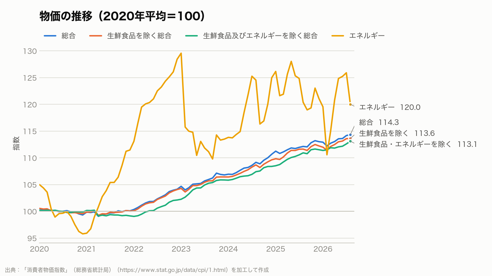
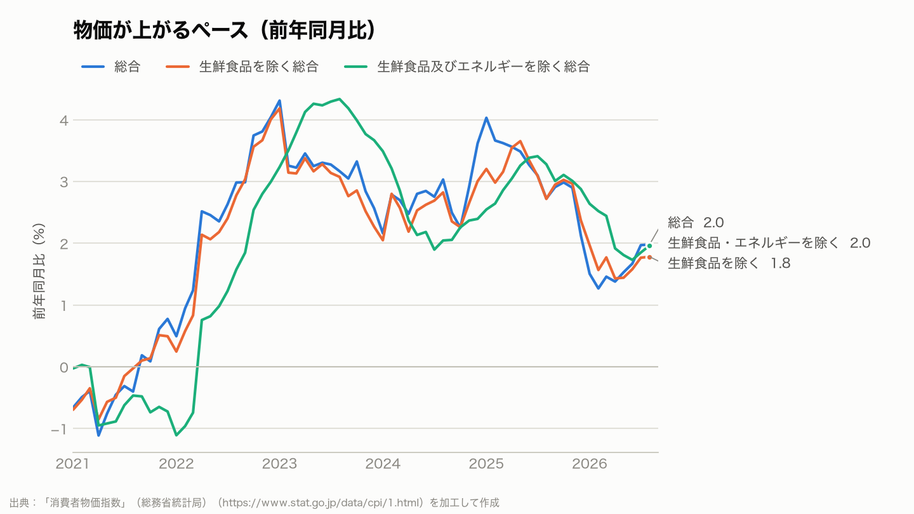
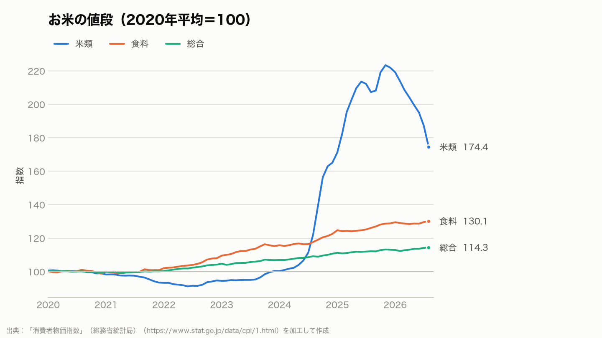
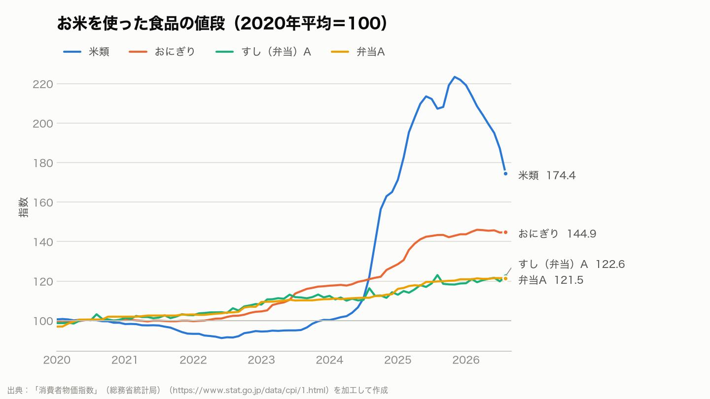

# 消費者物価指数で見る、この数年の物価とお米

2020 年から 2026年8月までの消費者物価指数（全国、2020 年平均＝100）から、物価全体の動きと、お米の値段の動きをまとめました。
分析の進め方は [分析計画書](docs/analysis-plan.md) に、計算はすべて [src/](src/) にあります。

## 要点

- 物価全体（総合）は 2026年8月に **114.3** で、2020 年より **14.3%** 高くなっています。
- 上がるペースが最も速かったのは 2023年1月で、前年同月比 **+4.3%** でした。直近（2026年8月）は +2.0% です。
- お米（米類）は 2025年11月に **223.4**（2020 年の約 2.2 倍）まで上がりました。2026年8月は 174.4 で、山から 22% 下がっています。
- おにぎりは 2026年8月に 144.9 で、山（2026年3月、146.0）からの下がり幅は 0.8% にとどまっています。

## Q-01 物価は、2020 年からどれくらい、いつごろ上がったか

<picture>
  <source media="(prefers-color-scheme: dark)" srcset="figures/o01-overall-index-dark.png">
  
</picture>

- 2021 年までは、ほぼ横ばいでした。2022 年から、総合・生鮮食品を除く総合・生鮮食品及びエネルギーを除く総合の 3 つがそろって上がり続けています。
- エネルギーは動きが大きく、2023年1月に 129.6 まで上がったあと、上下を繰り返しています（2026年8月は 120.0）。

<picture>
  <source media="(prefers-color-scheme: dark)" srcset="figures/o02-overall-yoy-dark.png">
  
</picture>

- 前年同月比で見ると、上がるペースには 2 つの山があります。総合の最大は 2023年1月の +4.3% です。
- 生鮮食品及びエネルギーを除く総合は、少し遅れて山を迎えています。エネルギーの値上がりが、ほかの品目に時間をかけて広がったように見えます（ここでは因果関係までは検証していません）。

## Q-02 お米の値段は、どう動いたか

<picture>
  <source media="(prefers-color-scheme: dark)" srcset="figures/o03-rice-index-dark.png">
  
</picture>

- 米類は 2023 年ごろまで 2020 年より低い水準でしたが、2024 年から急に上がり、2025年11月に 223.4 になりました。上がるペースの最大は 2025年5月の前年同月比 +101.7%（1 年で約 2 倍）です。
- 同じ期間の食料全体は 130.1、総合は 114.3 なので、お米の動きが際立っています。

<picture>
  <source media="(prefers-color-scheme: dark)" srcset="figures/o04-rice-foods-index-dark.png">
  
</picture>

- お米を使った食品も上がりましたが、上がり方はお米より小さく、おにぎり 144.9、すし（弁当）A 122.6、弁当 A 121.5 です（2026年8月）。
- お米が山から下がり始めたあとも、おにぎりや弁当はほとんど下がっていません。材料の値段が下がっても、商品の値段はすぐには戻らないようです（理由までは、このデータからはわかりません）。

## 表：系列ごとの最新値と山

| 系列 | 指数（2026年8月） | 前年同月比 | 指数の山 |
| --- | --- | --- | --- |
| 総合 | 114.3 | +2.0% | 2026年8月（114.3） |
| 生鮮食品を除く総合 | 113.6 | +1.8% | 2026年8月（113.6） |
| 生鮮食品及びエネルギーを除く総合 | 113.1 | +2.0% | 2026年8月（113.1） |
| エネルギー | 120.0 | -0.3% | 2023年1月（129.6） |
| 食料 | 130.1 | +3.2% | 2026年8月（130.1） |
| 米類 | 174.4 | -15.8% | 2025年11月（223.4） |
| うるち米A | 173.9 | -15.2% | 2025年11月（221.1） |
| うるち米B | 174.7 | -16.2% | 2025年11月（224.7） |
| おにぎり | 144.9 | +1.1% | 2026年3月（146.0） |
| 弁当A | 121.5 | +1.4% | 2026年6月（121.5） |
| 弁当B | 139.1 | +10.5% | 2026年5月（140.0） |
| すし（弁当）A | 122.6 | -0.4% | 2025年8月（123.0） |
| すし（弁当）B | 140.3 | +3.8% | 2026年8月（140.3） |

すべての月の値は [data/processed/cpi_selected.csv](data/processed/cpi_selected.csv)、年平均などは [data/processed/summary.csv](data/processed/summary.csv) にあります。

## 検証

計算が正しいことを、テストで確かめています（[分析計画書 §6](docs/analysis-plan.md#6-検証)）。

- 2020 年の各系列の年平均が 100 になること
- 2025 年平均の総合が、総務省統計局の公表値 111.9 と一致すること
- 元データが、取得したときのものから変わっていないこと（SHA-256）

## 再現の手順

```sh
uv sync
uv run cpi-analysis     # 検証 → 集計 → 図と表 → このレポート
uv run pytest
```

---

出典：「消費者物価指数」（総務省統計局）（https://www.stat.go.jp/data/cpi/1.html）を加工して作成
